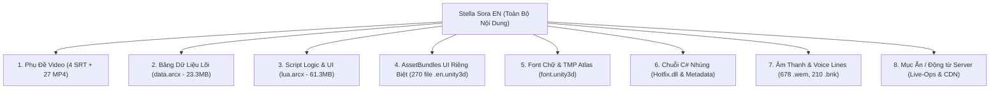

# Báo Cáo Rà Soát Toàn Bộ Các Mục Cần Việt Hóa (Stella Sora EN)
**Thời gian lập**: 19/10/2026  
**Phạm vi khảo sát**: Toàn bộ bản cài đặt thực tế `C:\YostarGames\StellaSora_EN` (16.220 tệp, ~30GB dữ liệu)

---

## 📌 Tổng Quan Bản Đồ Dữ Liệu Cần Việt Hóa

Qua quá trình quét sâu toàn bộ thư mục `StellaSora_Data`, `Persistent_Store`, `InstallResource`, các file `.manifest`, DLL và cấu trúc nhị phân, nội dung hiển thị trong game Stella Sora được phân bổ thành **8 Tầng Dữ Liệu Cần Việt Hóa** (từ dễ tiếp cận đến các mục ẩn sâu):

---

## 🔍 Chi Tiết Từng Tầng Mục Cần Việt Hóa

### TẦNG 1: Phụ Đề Rời & Video Cutscene
*Vị trí*: `Persistent_Store/Videos/` và `StellaSora_Data/StreamingAssets/InstallResource/`

1. **Các phụ đề rời đã xác minh (51 Cue - Đã dịch & Audit Đạt)**:
   - `Prologue-Prologue_P4_JPVA_FP_EN.srt` (14 cues): Phụ đề mở đầu lồng tiếng Nhật.
   - `Prologue-Prologue_P4_CNVA_FP_EN.srt` (14 cues): Phụ đề mở đầu lồng tiếng Trung (chứa issue `dffd` nguồn).
   - `CH04ED-CH04ED_EN.srt` (10 cues): Ca từ bài hát kết thúc Chapter 4.
   - `CH06ED-CH06ED_EN.srt` (13 cues): Ca từ bài hát kết thúc Chapter 6.
2. **Mục ẩn trong Video (27 Video MP4)**:
   - `CH09ED-CH09ED_FP.mp4` & `CH09ED_MP.mp4` (Ending Chapter 9): Bản EN hiện **chưa có file .srt rời đi kèm**. Cần kiểm tra xem video có bài hát/lời thoại cần tạo phụ đề tiếng Việt rời hoặc hardsub không.
   - `Prologue-Prologue_P1.mp4`, `P2.mp4`, `P3.mp4`: Các đoạn video dẫn truyện mở đầu trước P4.
   - `City_Main_1_7_Anime.mp4` (29.1 MB): Hoạt cảnh cốt truyện thành phố.
   - 14 video Gacha (`Gacha_001.mp4`, `Gacha_car_*.mp4`, `gacha_disc_*.mp4`): Chứa hoạt cảnh quay tướng, xe gacha, đĩa nhạc gacha (có thể có chữ tiếng Anh vẽ trong video như "PULL", "RATE UP", "SSR").
   - `Launch.mp4` (9.7 MB): Video mở đầu game lúc khởi động.

---

### TẦNG 2: Bảng Dữ Liệu Lõi (Core Game Tables - `data.arcx`)
*Vị trí*: `Persistent_Store/Tables/data.arcx` (23.321.879 bytes)  
*Định dạng*: Archive nhị phân BAR (`\x1a B A R`, version `0x66`, 102.400 blocks)

Đây là **nơi chứa khối lượng văn bản khổng lồ nhất của trò chơi** (ước tính 80% - 90% tổng số chữ):
- **Toàn bộ cốt truyện chính (Main Story dialogues)**: Toàn bộ lời thoại các chương cốt truyện, câu thoại dẫn chuyện, các nhánh lựa chọn câu trả lời của nhân vật chính.
- **Truyện nhân vật & Cốt truyện phụ (Bond / Character Stories)**: Tiểu sử nhân vật, đối thoại khi tăng độ thân mật, nhiệm vụ cá nhân.
- **Kỹ năng & Cơ chế chiến đấu**:
  - Tên kỹ năng (Normal, Skill, Ultimate).
  - Mô tả hiệu ứng kỹ năng, tỷ lệ phần trăm (%), thời gian duy trì, chỉ số buff/debuff.
  - Từ khóa trạng thái chiến đấu (Stun, Burn, Freeze, Shield, Crit Rate...).
- **Trang bị, Cổ vật (Artifacts), Vũ khí**: Tên trang bị, mô tả nguồn gốc lore, dòng thuộc tính chỉ số.
- **Nhiệm vụ & Thành tựu**: Tên và điều kiện hoàn thành nhiệm vụ ngày, tuần, chiến dịch, bảng danh hiệu.
- **Hội thoại thành phố (City NPC dialogues)**: Các câu thoại của cư dân Novian và Trekker khi đi dạo trong thành phố.
- **Bảng ánh xạ chuỗi hệ thống (System String Tables)**: Các nhãn văn bản cố định trong giao diện.

---

### TẦNG 3: Script Logic & Giao Diện Động (Lua Scripts - `lua.arcx`)
*Vị trí*: `Persistent_Store/Scripts/lua.arcx` (61.344.344 bytes)  
*Định dạng*: Archive BAR (`\x1a B A R`)

Chứa toàn bộ mã kịch bản gameplay và logic điều khiển giao diện:
- **Thông báo Popup & Cảnh báo nhanh (Toast Messages)**: Ví dụ: "Vật phẩm không đủ", "Kết nối lại máy chủ", "Mở khóa tính năng mới".
- **Lời thoại chiến đấu động (Battle Barks)**: Câu nói của nhân vật khi tung chiêu, khi bị đánh trúng, khi hồi máu hoặc khi thắng/thua trận.
- **Hướng dẫn tân thủ (Tutorial Steps)**: Chuỗi chỉ dẫn người chơi từng bước bấm vào màn hình.
- **Chuỗi định dạng tham số (Format strings)**: Cần giữ nguyên định dạng `{0}`, `{name}`, `%s`, `%d`.

---

### TẦNG 4: AssetBundles Giao Diện Riêng Biệt (270 File `.en.unity3d`)
*Vị trí*: `Persistent_Store/AssetBundles/`  
*Định dạng*: UnityFS AssetBundles (Unity 2022.3.62f2)

Game tách riêng toàn bộ tài nguyên ngôn ngữ tiếng Anh thành các bundle có đuôi `.en.unity3d`:
1. **230 tệp `ui_*.en.unity3d`**:
   - `ui_avg.en.unity3d`: Khung giao diện Visual Novel (Nút: Auto, Skip, Log, Hide, Fast Forward...).
   - `ui_battle.en.unity3d`: Giao diện chiến đấu (Nút: Pause, Retreat, Speed 1x/2x, Nút kỹ năng, chữ Victory/Defeat).
   - Hơn **40 tệp `ui_activity_*.en.unity3d`**: Giao diện các sự kiện in-game theo mùa và giới hạn thời gian (Event banners, nhiệm vụ sự kiện, phần thưởng sự kiện).
   - Các màn hình UI: Gacha, Cửa hàng (Shop), Túi đồ (Inventory), Nâng cấp nhân vật, Đội hình, Bang hội (Guild), Cài đặt (Settings).
2. **32 tệp `icon-*.en.unity3d`**:
   - `icon-0.en.unity3d` đến `icon-f.en.unity3d`: Các icon đồ họa có vẽ chữ tiếng Anh (chữ "NEW", "HOT", "SALE", "RATE UP", "FREE", "LOCKED", "LV UP").

---

### TẦNG 5: Font Chữ & Hiển Thị Ký Tự Tiếng Việt (Font Assets)
*Vị trí*: `font.unity3d` và các bundle TextMeshPro đi kèm

- **Thách thức**: Font mặc định của game tiếng Anh chỉ tạo SDF Atlas cho bảng chữ cái Latin cơ bản (ASCII).
- **Mục cần xử lý**: Tiếng Việt gồm **134 ký tự có dấu** (ă, â, đ, ê, ô, ơ, ư, các dấu sắc, huyền, hỏi, ngã, nặng).
- **Yêu cầu kỹ thuật**:
  - Cần bổ sung glyph tiếng Việt vào TextMeshPro Font Asset hoặc thiết lập cơ chế **Font Fallback** trỏ đến font hệ thống hỗ trợ tiếng Việt (như Arial, Roboto, Noto Sans).
  - Tránh lỗi hiển thị ký tự ô vuông (tofu `□`) hoặc nhảy cỡ chữ.

---

### TẦNG 6: Chuỗi C# Nhúng & Mã Máy Ảo (Mục Ẩn Sâu)
*Vị trí*:
- `Persistent_Store/Scripts/hotfix.arch` & `Hotfix.dll` (13.1 MB - C# Assembly)
- `StellaSora_Data/il2cpp_data/Metadata/global-metadata.dat` (29.3 MB)
- `GameAssembly.dll` (128 MB)

- **Đặc điểm**:
  - `Hotfix.dll`: Chứa logic cập nhật nóng của game, các thông báo lỗi mạng, chuỗi xác thực tài khoản.
  - `global-metadata.dat`: Header có magic `0x1357feda` (đã qua lớp mã hóa/xáo trộn của AntiCheatExpert).
- **Nguyên tắc**: Không chỉnh sửa trực tiếp vào file nhị phân DLL hay can thiệp anti-cheat để tránh nguy cơ tài khoản bị cấm hoặc xung đột khi cập nhật.

---

### TẦNG 7: Tài Nguyên Âm Thanh & Lời Thoại (Voice Lines)
*Vị trí*: `Persistent_Store/SoundBanks/` (678 tệp `.wem`, 210 tệp `.bnk` Wwise)

- Chứa toàn bộ giọng lồng tiếng của nhân vật:
  - Bản lồng tiếng Nhật: `JPVA` (hậu tố `_jp.wem`).
  - Bản lồng tiếng Trung: `CNVA` (hậu tố `_cn.wem`).
- **Lưu ý**: Lời thoại tiếng Việt trong phụ đề phải tôn trọng ngữ khí và thời lượng khớp với giọng nói gốc của diễn viên lồng tiếng.

---

### TẦNG 8: Mục Ẩn Động Từ Máy Chủ (Server-Side / CDN Live-Ops)
- Các banner thông báo sự kiện khẩn cấp, thư quà tặng từ hệ thống (Mailbox), bảo trì máy chủ được gửi trực tiếp dưới dạng chuỗi JSON/HTML từ máy chủ của Yostar khi người chơi kết nối mạng.
- Các mục này nằm trên máy chủ từ xa, không thể patch offline vào client.

---

## 📊 Bảng Tổng Hợp Ưu Tiên Việt Hóa

| Tầng nội dung | Dung lượng / Số lượng | Mức độ ưu tiên | Trạng thái kỹ thuật |
|---|:---:|:---:|:---:|
| **1. Phụ đề Video (SRT)** | 4 file (51 cue) | **P0 (Cao nhất)** | **Đã hoàn thành 100% (Audit 0 lỗi)** |
| **2. Bảng dữ liệu (`data.arcx`)** | 23.3 MB (~100k chuỗi) | **P0 (Cốt lõi)** | Cần giải mã định dạng BAR `1a424152` |
| **3. Font tiếng Việt (`font.unity3d`)** | ~10 MB | **P0 (Bắt buộc)** | Cần nạp Fallback Glyph tiếng Việt |
| **4. AssetBundles UI (`.en.unity3d`)** | 270 file (~400 MB) | **P1 (Quan trọng)** | AssetBundles UnityFS, trích xuất text/ảnh |
| **5. Script UI & Logic (`lua.arcx`)** | 61.3 MB | **P1 (Quan trọng)** | Script Lua đóng gói cùng format BAR |
| **6. Video MP4 bổ sung** | 27 file (~1 GB) | **P2 (Trung bình)** | Kiểm tra hardsub / tạo SRT nếu cần |
| **7. Chuỗi C# trong Hotfix.dll** | 13.1 MB | **P3 (Thấp / Ẩn)** | Nghiên cứu sau khi hoàn thành data |
| **8. Dữ liệu Server Live-Ops** | Động qua CDN | **Không khả thi** | Dữ liệu thời gian thực từ máy chủ |
